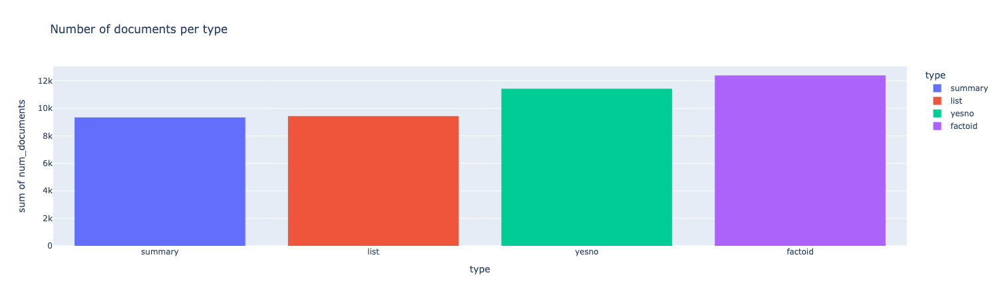
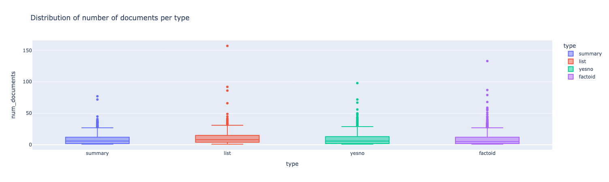

# BioASQ-QA: A manually curated corpus for Biomedical Question Answering

## What the data is

BioASQ-QA is a set of about **4,700 biomedical questions** (as of the 2023 paper) written by **21 domain experts** from
European universities, hospitals and research institutes. Each question comes from a real information need in the
expert's own work. Around 500 new questions are added every year.

For each question, the expert:

1. Searched PubMed for relevant articles.
2. Picked the articles that are **sufficient** to answer it. This is not every relevant article.
3. Highlighted the exact sentences that answer it. These are the **snippets**.
4. Wrote a short **exact answer** and a one-paragraph **ideal answer**, based only on those snippets.

Since 2016 everything uses **PubMed abstracts only**, not full text.

So each question is a ready-made RAG test case: the question, the documents a retriever should find, the evidence
passages a generator should cite, and the reference answer.

## The four question types

| Type      | Exact answer                         | Example                                                                       |
|-----------|--------------------------------------|-------------------------------------------------------------------------------|
| `yesno`   | `"yes"` or `"no"`                    | Do CpG islands colocalise with transcription start sites?                     |
| `factoid` | One entity, with its synonyms        | Which virus is best known as the cause of infectious mononucleosis?           |
| `list`    | Several entities, each with synonyms | Which are the Raf kinase inhibitors?                                          |
| `summary` | None, only the ideal answer          | How does dabigatran therapy affect aPTT in patients with atrial fibrillation? |





## What's in the JSON

The file is one object holding a `questions` array. Here is one question, annotated:

```jsonc
{
  "questions": [
    {
      "id": "55031181e9bde69634000014",      // unique question ID
      "type": "factoid",                      // yesno | factoid | list | summary
      "body": "Which virus is best known as the cause of infectious mononucleosis?",

      // RETRIEVAL GOLD: articles the expert judged sufficient to answer
      "documents": [
        "http://www.ncbi.nlm.nih.gov/pubmed/23634311",   // PMID is the number at the end
        "http://www.ncbi.nlm.nih.gov/pubmed/21258187"
      ],

      // EVIDENCE GOLD: exact sentences inside those articles
      "snippets": [
        {
          "document": "http://www.ncbi.nlm.nih.gov/pubmed/23634311",
          "text": "Epstein-Barr virus (EBV) is the causative agent of infectious mononucleosis...",
          "beginSection": "abstract",       // "title" or "abstract"
          "endSection": "abstract",
          "offsetInBeginSection": 0,        // character start within that section
          "offsetInEndSection": 78          // character end within that section
        }
      ],

      // SHORT ANSWER: shape depends on type
      "exact_answer": [["Epstein-Barr virus", "EBV", "human herpesvirus 4"]],

      // LONG ANSWER: expert-written paragraph(s)
      "ideal_answer": [
        "Infectious mononucleosis is caused mainly by Epstein-Barr virus (EBV)..."
      ],

      // OPTIONAL, older questions mostly
      "concepts": ["http://www.nlm.nih.gov/cgi/mesh/2014/MB_cgi?field=uid&exact=true&term=D007244"],
      "triples": [{ "s": "...", "p": "...", "o": "..." }]
    }
  ]
}
```

### Field by field

| Field          | Meaning                                   | How F1 uses it                                            |
|----------------|-------------------------------------------|-----------------------------------------------------------|
| `id`           | Question identifier                       | Joins everything together                                 |
| `type`         | One of the four types                     | Decides how you score the answer                          |
| `body`         | The question text                         | Input to your system                                      |
| `documents`    | PubMed URLs of gold articles              | **qrels** for recall@k, MRR, NDCG@10                      |
| `snippets`     | Gold sentences with location              | **Citation recall**: did you cite what the expert marked? |
| `exact_answer` | Short answer                              | Accuracy or F1 for yes/no, factoid, list                  |
| `ideal_answer` | Expert paragraph                          | Reference for your LLM judge (faithfulness, completeness) |
| `concepts`     | MeSH, GO, UniProt, Disease Ontology links | Optional ontology layer; skip for v1                      |
| `triples`      | Linked Life Data facts                    | Abandoned by BioASQ; ignore                               |

### The `exact_answer` shapes (what trips people up)

```jsonc
"exact_answer": "yes"                                   // yesno
"exact_answer": [["Epstein-Barr virus", "EBV"]]         // factoid: one entity, synonyms
"exact_answer": [["sorafenib", "BAY 43-9006"],          // list: one inner list per entity
                 ["vemurafenib"]]
// summary: field missing or empty
```

Older years store some of these inconsistently, for example factoid synonyms as a flat list. That's why
`bioasq_extract.py` normalises them all into one shape.

### Snippet offsets

`offsetInBeginSection` and `offsetInEndSection` are character positions **within the title or abstract** named in
`beginSection`/`endSection`, not within the whole article. Since PubMed abstracts sometimes get edited after annotation,
offsets can drift. That's why the script checks alignment using the snippet `text` instead of trusting offsets.

## What's NOT in the JSON

* **No abstract text.** Only PubMed URLs. You fetch titles and abstracts yourself, which is what the `fetch` step does.
* **No negative or irrelevant documents.** You build distractors yourself, for example with ELink "similar articles".
* **No full text.** Abstracts only.

## Check it yourself on the real file

I couldn't open the paper's Table 5 directly (the site blocks automated access to it), so the structure above comes from
the standard BioASQ format. Confirm it against your download in a minute:

```bash
python3 -c "
import json; d=json.load(open('training11b.json'))
q=d['questions'][0]
print(len(d['questions']), 'questions')
print(sorted(q.keys()))
print(json.dumps(q, indent=2)[:1500])"
```

If any field differs from what's above, paste the output and I'll adjust the extractor.

Sources:

- [BioASQ-QA: A manually curated corpus for Biomedical Question Answering](https://www.nature.com/articles/s41597-023-02068-4)
- [JSON Data Link](https://zenodo.org/records/7655130)
- [BioASQ_raw.json](BioASQ_raw.json)
- [Participation Site](https://participants-area.bioasq.org/)